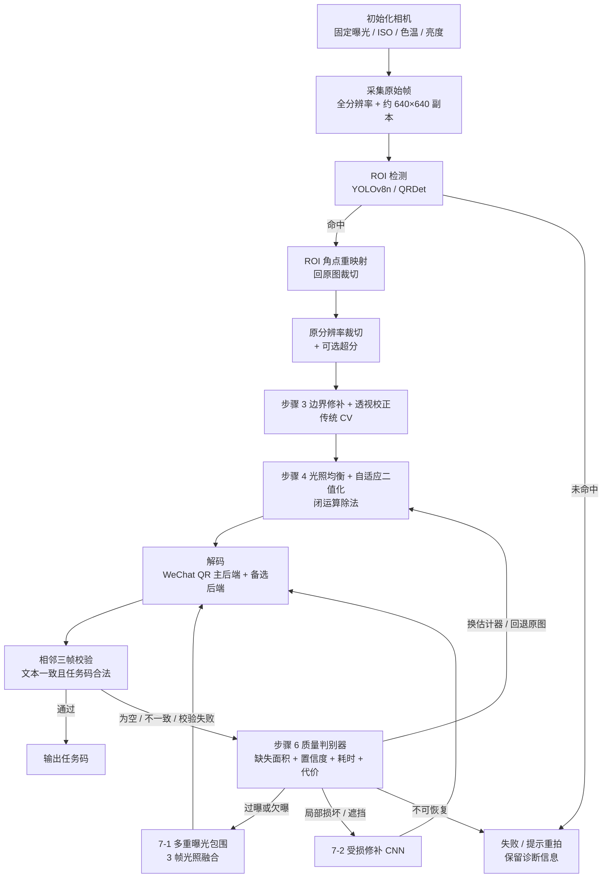

# High-robustness Scanning and Hierarchical Architecture

> 比赛扫码任务的联合开发仓库。当前阶段只做**静止二维码**；运动扫码、多码同帧、其他码制暂不进入本期验收范围。

## 1. 当前目标

在机器人**停稳后**，对现场唯一一块二维码板完成高鲁棒读取，并给出可解释的失败原因。当前流程如下：

1. 相机按预设固定曝光、ISO、色温、亮度等参数，采集原始帧；将原始帧压缩到约 640×640，送入 YOLOv8n / QRDet 做 ROI 检测（视场角过大或二维码过远时启用）。
2. 用 ROI 角点把目标区域**重映射回原图**并裁切；分辨率不足时评估超分或二维码专用重构。
3. 必要时用传统 CV 修补边界，并做透视校正。
4. 使用“闭运算估计光照 + 除法均衡 + 自适应二值化”解决光照不均；噪声大时先滤波。
5. 输入微信二维码识别器，连续 3 帧校验；不一致或为空时按置信度回退到第 3 步之后（重新二值化/换路）。
6. 过曝/欠曝导致信息缺失时，由判别器综合缺失面积、CNN 处理时间、置信度和代价函数，选择后续路径：
   - 7-1 多重曝光包围：以上一预设值和阈值分别拍 3 张，按光照拼合后回到第 5 步；
   - 7-2 受损修补 CNN：把局部损坏的码修到可读后回到第 5 步。

> **团队决定**：现场一帧最多出现一个合法任务码；扫码只在静止时进行。  
> **当前开发重点**：第 4 步（本仓库 `layers/04_binarize`），由本模块负责人重构旧实验代码，并补齐“扫描线 vs Canny”对照实验。

## 2. 总体流程



图中的“步骤 4”对应本仓库 `layers/04_binarize`。仓库在任务描述的步骤 1 内额外拆出了独立的采集阶段 `00_capture`，但二值化仍保持第 4 步的编号，便于和原流程对照。

## 3. 分层与目录

每个流水线阶段独立一个目录，内部统一为：

```text
layers/<阶段>/
├── README.md          # 职责、接口、数据、实验、状态
├── include/qrscan/    # 对外公开头文件（对接其他架构）
├── src/               # 实现
├── tests/             # 单元/集成测试
├── data/input/        # 本阶段输入样本（小样本入库，大集外置）
├── data/output/       # 处理结果（默认不入 Git）
└── experiments/       # 对照实验脚本、配置、结果
```

| 目录 | 对应步骤 | 职责 | 状态 |
|---|---|---|---|
| `common/` | — | 公共类型、配置、图像/指标工具 | 待定义 |
| `layers/00_capture` | 1a | 相机预设、原始帧、包围曝光采集 | 骨架 |
| `layers/01_roi_detect` | 1b | YOLOv8n / QRDet ROI 检测 | 骨架 |
| `layers/02_geometry` | 2 | 角点重映射、原图裁切、可选超分 | 骨架 |
| `layers/03_restore` | 3 | 传统边界修补、透视校正 | 骨架 |
| `layers/04_binarize` | 4 | 光照均衡 + 自适应二值化；扫描线/Canny 可切换 | **已实现 + 实验** |
| `layers/05_decode` | 5 | WeChat / ZXing 解码、三帧校验 | 骨架 |
| `layers/06_quality` | 6 | 质量判别、缺失面积、代价函数 | 骨架 |
| `layers/07a_multiexposure` | 7-1 | 多重曝光包围与融合 | 骨架 |
| `layers/07b_inpaint` | 7-2 | 受损二维码 CNN 修补 | 骨架 |
| `layers/08_pipeline` | 编排 | 状态机、回退、超时、遥测 | 骨架 |
| `apps/` | — | CLI 与批量评估入口 | 待定义 |
| `datasets/` | — | 各阶段数据目录；当前步骤 4 已内置 53 张 | 已内置 |
| `models/` | — | 模型权重（不入普通 Git） | 待定 |
| `python/` | — | 离线训练/导出/实验编排/绑定 | 待定 |
| `third_party/` | — | 第三方依赖的构建脚本或子模块 | 待定 |
| `tools/` | — | 数据采集、标注、可视化工具 | 待定 |

## 4. 技术栈与混编边界

- **实时路径全部 C++**：C++17 起步（如依赖要求可升 C++20），OpenCV 4.x，ONNX Runtime / TensorRT 作为可选推理后端。
- **Python 只做离线工作**：模型训练、导出、批量实验编排、结果绘图、与论文参考实现逐像素对照。实时链路不调用 Python。
- **混编方式**：优先 pybind11 暴露 C++ 阶段给 Python 实验脚本；跨进程场景再用文件/JSON 交换。接口以 C++ 头文件为唯一权威。
- **不引入 ROS/ROS2**：沿用旧项目的非 ROS 约束，进程/线程模型由 `08_pipeline` 统一决定。

## 5. 数据与实验

- 每个阶段自带 `data/input` 与 `data/output`，用于**小样本冒烟**和单阶段复现。
- 当前需要的 53 张唯一图直接放在 `layers/04_binarize/data/input/qr_samples/`，随仓库提交，不依赖外部路径或数据集注册表。
- 大文件（视频、模型权重、完整数据集）**不进普通 Git**；需要入库时用 Git LFS 或发布包。
- 任何实验必须记录：Git commit、配置哈希、OpenCV/后端版本、数据集清单哈希、运行时间、机器信息。
- 指标报告必须区分“模块估计正确”“解码并集成功”“单路成功”，不能只报一个总数。详见 [`docs/04-experiments.md`](docs/04-experiments.md)。

## 6. 协作约定

1. **接口先冻结再并行**：跨阶段数据结构与状态码以 [`docs/03-interfaces.md`](docs/03-interfaces.md) 为准；改接口需在 PR 中说明影响面。
2. **单向依赖**：阶段只依赖 `common/`，不反向依赖 `08_pipeline`；阶段之间不直接 `#include` 对方实现。
3. **阶段内不做文件 I/O**：读写图片、遍历数据集放在 `apps/`、`tools/`、`experiments/`。
4. **失败可降级**：任何模型/后端缺失时，阶段必须能返回“不可用”状态，而不是崩溃或静默给出错误结果。
5. **实验可复现**：一次实验一个 `run_id`，输出目录包含 `run_meta.json` 与 `metrics.json`。
6. **提交粒度**：一个 PR 只做一件事；算法改动必须附对照数据，不能只写“感觉更好”。

## 7. 文档索引

| 文档 | 内容 |
|---|---|
| [`docs/01-architecture.md`](docs/01-architecture.md) | 分层原则、依赖关系、目录约定、C++/Python 边界 |
| [`docs/02-pipeline.md`](docs/02-pipeline.md) | 完整流水线、状态机、回退语义、代价函数 |
| [`docs/03-interfaces.md`](docs/03-interfaces.md) | 公共数据结构、阶段接口、配置、坐标与状态码 |
| [`docs/04-experiments.md`](docs/04-experiments.md) | 数据集、指标、实验矩阵、复现规范 |
| [`docs/05-roadmap.md`](docs/05-roadmap.md) | 里程碑、分工、验收标准、风险 |
| [`layers/04_binarize/README.md`](layers/04_binarize/README.md) | 当前重点模块的算法、接口、迁移与实验计划 |

## 8. 当前状态

- `04_binarize` 已完成 C++ 实现、CLI、批量评估、单元测试和 53 张唯一图实验；其余阶段为接口与目录骨架。
- 实验主结果：[`step4_baseline/report.md`](layers/04_binarize/experiments/results/step4_baseline/report.md)。`hybrid` 在 53 张上 0 失败、模块误差 max 0.19 px、三路 union 52/53。
- 当前数据集 53 张随仓库提交，不依赖外部路径或注册表。

## 9. 快速开始

```bash
# 配置（Windows 示例；OpenCV_DIR 指向本机 OpenCV 4.x）
cmake -S . -B build -G Ninja -DCMAKE_BUILD_TYPE=Release \
      -DOpenCV_DIR=<opencv4>/lib/cmake/opencv4
cmake --build build -j 4

# 单元/冒烟测试
./build/test_binarize

# 单图：输出 input/illumination/equalized/binary/montage/result.json
./build/qrscan_cli --image layers/04_binarize/data/input/qr_samples/clean_200_00.png \
                   --estimator hybrid --out out/clean_200

# 53 张批量实验
./build/qrscan_eval --dataset layers/04_binarize/data/input/qr_samples \
                    --out layers/04_binarize/experiments/results/step4_baseline \
                    --run-id step4_baseline
```

> Windows 运行时如果同时装了 MSYS2 和 vcpkg，建议把 vcpkg 的 `bin` 放到 `PATH` 最前，避免
> `libprotobuf.dll` 等版本冲突导致进程无法启动。
