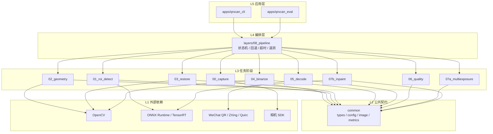

# 01 架构：分层、依赖与边界

## 1. 设计目标

1. **高鲁棒**：每一阶段都能说明自己何时失败、失败后交给谁、代价是多少。
2. **可分层替换**：ROI 检测器、超分、修补网络、解码后端、二值化器都可以单独换实现，不牵动整条链路。
3. **可离线复现**：同一帧 + 同一配置 + 同一版本，输出逐像素一致；实验数据可回溯。
4. **联合开发友好**：每个阶段一个目录、一个公开接口、一组数据；队员可以并行开发而不互相踩实现。

## 2. 分层原则

- **单向依赖**：`apps → 08_pipeline → 阶段模块 → common`。阶段模块之间不直接依赖对方实现；需要组合时由 `08_pipeline` 注入接口。
- **阶段是纯变换**：`输入图像/帧 + 配置 → 输出图像/结果 + 诊断`；不持有全局状态，不修改输入 `cv::Mat` 的像素。
- **阶段内不做文件 I/O**：读写图片、遍历数据集、保存中间图只在 `apps/`、`tools/`、`experiments/` 完成。
- **接口以头文件为权威**：跨阶段的数据结构、状态码、单位、坐标约定统一放 `common/include/qrscan/common/`。
- **可降级**：模型缺失、后端不可用、输入退化时返回明确状态；禁止异常穿过阶段边界。
- **不在实时路径引入 Python**：Python 只做训练、导出、离线实验和可视化。

## 3. 依赖分层



> 箭头方向表示“依赖/调用方向”。`common` 不依赖任何阶段；`08_pipeline` 是唯一知道完整流程的模块。

## 4. 阶段与流水线步骤映射

| 仓库目录 | 任务描述中的步骤 | 主要输入 | 主要输出 | 失败时 |
|---|---|---|---|---|
| `layers/00_capture` | 1（采集部分） | 相机参数预设 | `Frame` + `CameraSettings` | 返回采集错误，不产生空帧 |
| `layers/01_roi_detect` | 1（ROI 部分） | 640×640 副本 | `RoiProposal` 列表 | `valid=false`，流水线可回退全幅 |
| `layers/02_geometry` | 2 | 原图 + ROI 四角 | `RoiImage`（原分辨率裁切/超分） | 返回原图裁切 + 低置信度 |
| `layers/03_restore` | 3 | `RoiImage` + 可选定位图案 | 修补/透视校正后的 `RoiImage` + 掩膜 | 原样透传，标记未处理 |
| `layers/04_binarize` | 4 | 灰度 ROI | 光照图、均衡图、二值图、`ScaleEstimate`、质量指标 | 返回多路结果 + 低置信度，不抛异常 |
| `layers/05_decode` | 5 | 多路图像 + 相邻帧 | `DecodeResult` + 校验状态 | 明确区分空文本/非法任务码/后端不可用 |
| `layers/06_quality` | 6 | 图像 + 解码诊断 | `QualityReport` + `Action` | 默认 `kFail`，不猜 |
| `layers/07a_multiexposure` | 7-1 | 相机 + 当前参数 | 融合帧 | 融合失败则回退单帧 |
| `layers/07b_inpaint` | 7-2 | 受损 ROI + 掩膜 | 修补 ROI + 不确定性 | 模型缺失则回退传统修补 |
| `layers/08_pipeline` | 整体 | 一帧或多帧 + 配置 | `PipelineResult` | 超时/预算耗尽时返回最佳诊断 |

## 5. 目录约定

每个阶段必须保持以下结构（可以按需增加 `config/`、`bindings/`）：

```text
layers/<阶段>/
├── README.md              # 职责、输入输出、接口、数据、实验、状态
├── include/qrscan/<层>/   # 公开头文件，供其他模块 include
├── src/                   # 实现，不对外暴露内部头
├── tests/                 # 单元测试 + 黄金样本回归
├── data/input/            # 本阶段数据；当前 04 已内置 53 张唯一图
├── data/output/           # 运行结果，默认不入 Git
└── experiments/           # 对照实验脚本、配置、metrics、报告
```

**数据边界**：

- 单阶段可复现所需的小样本（几十张以内）随仓库提交。
- 当前需要的 53 张唯一图直接放在 `layers/04_binarize/data/input/qr_samples/`；后续阶段需要新数据时各自放入自己的 `data/input/`，不依赖外部注册表或环境变量。
- 数据集、视频、模型权重中体积较大的部分，后续再决定是否用 Git LFS 或发布包；当前仓库只包含步骤 4 需要的 1.7 MB 图像。

## 6. C++ / Python 混编边界

| 工作 | 语言 | 说明 |
|---|---|---|
| 实时采集、预处理、解码、决策 | C++ | 全部在 `layers/` 与 `08_pipeline` |
| 模型推理 | C++ | ONNX Runtime 或 TensorRT；模型文件外置 |
| 模型训练、导出、量化 | Python | 放 `python/training/`、`python/export/` |
| 批量实验编排、指标统计、绘图 | Python | 放 `layers/*/experiments/` 或 `python/experiments/` |
| C++ 阶段给 Python 调用 | pybind11 | 只暴露稳定接口，不暴露内部实现 |
| 论文参考实现逐像素对照 | Python | 作为黄金参考，不进入实时链路 |

**规则**：任何 Python 脚本不得成为线上链路的运行时依赖；如果某个算法只能在 Python 下验证，先以离线实验形式存在，C++ 移植并通过黄金对照后再接入。

## 7. 配置与可复现

- 一份主配置 `config/pipeline.json`，按阶段分节；阶段内默认值写在 C++ 配置结构里，JSON 只覆盖。
- 实验配置放 `layers/<阶段>/experiments/configs/`，不修改主配置。
- 配置结构带 `api_version`；不兼容变更必须升版本并写迁移说明。
- 每次运行写 `run_meta.json`，配置哈希用规范化 JSON 的 SHA-256。

## 8. 失败与降级

状态码统一使用 `common` 中的枚举，禁止用空字符串/空 Mat 隐式表示多种失败：

- `kOk`：阶段完成。
- `kInvalidInput`：输入尺寸/通道/深度不合法。
- `kNotFound`：ROI/定位图案/文本未找到。
- `kLowConfidence`：有结果但置信度不足以下结论。
- `kUnsaturatedInfoLost`：过曝/欠曝导致信息不可逆丢失。
- `kModelUnavailable`：模型或后端不可用。
- `kTimeout`：超出该阶段预算。
- `kInternalError`：未预期错误，必须带诊断信息。

降级顺序由 `08_pipeline` 决定；阶段自己只报告状态和建议动作，不擅自切换全局策略。

## 9. 坐标与单位约定

- 图像：BGR 8U；灰度图为单通道 8U；所有阶段输入输出都显式标注通道数。
- 坐标：原点在左上角，`x` 向右，`y` 向下；ROI 四角按顺时针顺序，从左上开始。
- `module_px`：二维码单个模块在**当前输入图**中的像素宽度；ROI 缩放后必须同步更新。
- 所有时间单位：毫秒（`double`）；时间戳：纳秒（`int64_t`）。
- 物理尺寸换算只在标定模块完成；`04_binarize` 不输出毫米。

## 10. 待确认

- [ ] 相机 SDK 与包围曝光能力（是否支持硬件 bracketing）。
- [ ] ROI 检测模型选型：YOLOv8n、QRDet 或两者并联。
- [ ] 超分/修补模型是否上 Jetson TensorRT，以及可接受的尾延迟。
- [ ] 主配置文件的最终字段与 `api_version=1` 的冻结时间。
