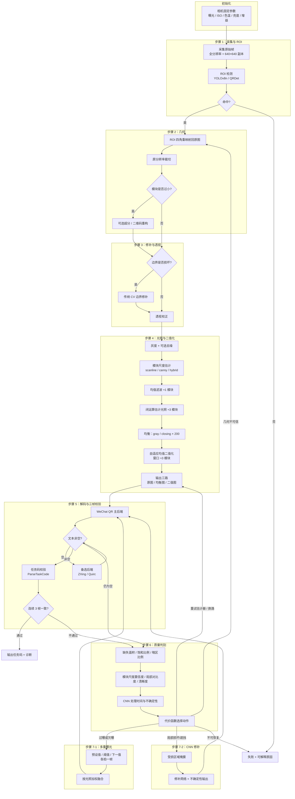
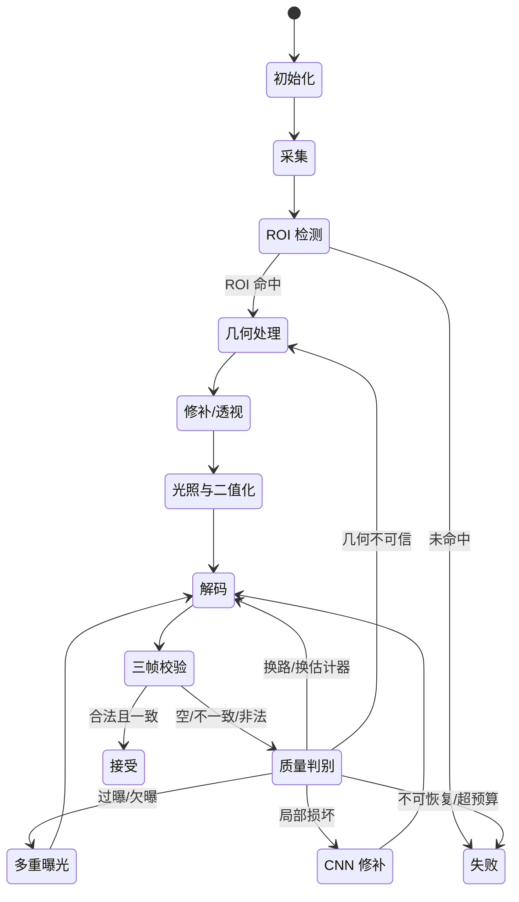

# 02 流水线：步骤、状态机与回退

> 本文描述**目标流程**（尚未全部实现）。当前只有 `04_binarize` 进入重构；其余阶段为接口骨架。
> 任务描述中的步骤编号保持不变：步骤 1 采集+ROI、步骤 2 重映射/裁切、步骤 3 修补/透视、步骤 4 光照均衡+二值化、步骤 5 解码+三帧校验、步骤 6 质量判别、步骤 7-1/7-2 两条恢复分支。

## 1. 完整数据流



## 2. 每步的输入、输出与失败语义

| 步骤 | 输入 | 输出 | 成功条件 | 失败语义 |
|---|---|---|---|---|
| 初始化 | 配置 | `CameraSettings` | 参数在相机界内 | `kInvalidInput` / `kModelUnavailable` |
| 采集 | `CameraSettings` | `Frame`（BGR + 时间戳 + 参数快照） | 非空、曝光未截断 | `kTimeout` / `kInvalidInput` |
| ROI | 640×640 副本 + 原图尺寸 | `RoiProposal{quad, confidence, detector}` | 四角在画面内、面积合理 | `kNotFound` |
| 重映射/裁切 | 原图 + quad | `RoiImage`（原分辨率） | 裁切非空、角点顺序正确 | `kInvalidInput` |
| 超分/重构 | `RoiImage` + `module_px` | 放大后的 `RoiImage` | 模块尺度达到下限 | `kLowConfidence` / `kModelUnavailable` |
| 透视校正 | `RoiImage` + 定位图案/quad | 校正后的 `RoiImage` | 单应可逆、输出尺寸合理 | `kInvalidInput` |
| 边界修补 | `RoiImage` + 损伤掩膜 | 修补后的 `RoiImage` + 掩膜 | 未引入大面积伪影 | `kLowConfidence` |
| 光照均衡 | 灰度 ROI | `illumination` / `equalized` | 尺度估计有效 | `kNotFound` / `kLowConfidence` |
| 二值化 | 均衡图 + `module_px` | `binary` | 窗口合法、输出非全黑/全白 | `kLowConfidence` |
| 解码 | 三路图像 | `DecodeResult` | 文本非空 | `kNotFound` |
| 任务码校验 | 文本 | `TaskCode` 或诊断 | 符合赛规格式 | `kLowConfidence` |
| 三帧校验 | 3 个 `DecodeResult` | 接受/歧义/重试 | 文本一致且任务码合法 | `kLowConfidence` |
| 质量判别 | 图像 + 诊断 | `QualityReport` + `Action` | 证据足够 | `kLowConfidence` |
| 多重曝光 | 相机 + 当前参数 | 融合帧 | 融合后无新增饱和 | `kTimeout` |
| CNN 修补 | 受损 ROI + 掩膜 | 修补 ROI + 不确定性 | 不确定性低于阈值 | `kModelUnavailable` / `kLowConfidence` |

## 3. 三帧校验与回退语义

### 3.1 接受规则

1. 任一帧解出文本且 `ParseTaskCode` 通过 → 候选。
2. 连续 3 帧中至少 2 帧给出**相同**合法任务码 → 接受。
3. 只有 1 帧给出合法码，另外 2 帧为空 → 按“单帧合法 + 质量置信度”决定是否接受；默认接受，但记录 `single_frame_accept=true`。
4. 两帧给出**不同**合法码 → 标记 `ambiguity`，不静默选择；交给上层/操作员。
5. 文本非空但 `ParseTaskCode` 不通过 → 绝不产生 `TaskCode`；继续尝试备选后端或下一帧。

> 现场约束是一帧最多一个合法任务码，因此不做多码投票；但“非任务码文本挡住回退”是已知结构性风险，必须显式记录。

### 3.2 回退层级

从便宜到贵：

1. **换路解码**：原图 / 均衡图 / 二值图三路都尝试；不能只用二值图覆盖原图（旧实验已出现失败集合不重叠）。
2. **换估计器**：Canny 失败或置信度低 → 回退扫描线；扫描线也失败 → 保留低置信度结果。
3. **回退步骤 2/3**：几何/修补可疑时，重新裁切或换透视/修补参数。
4. **多重曝光**：过曝/欠曝导致信息不可逆丢失时优先；代价是 3 次采集。
5. **CNN 修补**：局部损坏/遮挡且未饱和时优先；代价是模型延迟与生成错误模块的风险。
6. **失败**：以上都不可用或超时，返回可解释原因。

### 3.3 关键约束

- 步骤 4 必须同时输出**原图、均衡图、二值图**三路；旧实验在 40 张光照样本上单路最高 39/40，三路并集 40/40。
- 二值图不能作为唯一输出；解码器对二值化的响应并不总是一致。
- 任何“修补/超分/生成”路径都必须带掩膜和不确定性；不能把生成结果当作原始观测。
- 多重曝光融合只做光照加权，不做生成式补全；它不解决已经饱和的像素。

## 4. 判别器与代价函数（步骤 6）

### 4.1 质量报告字段

| 字段 | 含义 | 用途 |
|---|---|---|
| `saturation_ratio` | 灰度 ≥ 250 的像素比例 | 判断过曝，信息是否不可逆丢失 |
| `dark_ratio` | 灰度 ≤ 5 的像素比例 | 判断欠曝/阴影死区 |
| `missing_area_ratio` | 估计的不可读模块面积 / 码面积 | 判断是否需要修补或重拍 |
| `module_px` + `scale_confidence` | 模块尺度与置信度 | 判断二值化窗口是否可信 |
| `local_contrast` | 局部对比度（如 CLAHE 后的标准差） | 判断是否还有可恢复信息 |
| `sharpness` | Laplacian 方差 | 判断模糊/对焦 |
| `cnn_latency_ms` | 修补/超分模型耗时 | 进入代价函数 |
| `cnn_uncertainty` | 模型不确定性/重建残差 | 判断生成结果可信度 |

### 4.2 动作集合

| 动作 | 代价 | 风险 | 适用条件 |
|---|---|---|---|
| `kDecodeOtherRoute` | 极低 | 低 | 任一路失败、其他路未试 |
| `kRetryEstimator` | 低 | 低 | 尺度置信度低、Canny/扫描线结果冲突 |
| `kBackToGeometry` | 中 | 中 | 角点/透视可疑 |
| `kMultiExposure` | 高（3 帧采集+融合） | 低（真实观测） | 饱和/欠曝比例高 |
| `kInpaint` | 高（模型） | 高（生成错误模块） | 局部损坏/遮挡、未饱和 |
| `kSuperRes` | 中-高 | 中 | 模块过小、分辨率不足 |
| `kFail` | 低 | — | 信息不可恢复或预算耗尽 |

### 4.3 代价函数（初始提案，待标定）

```text
C(a) = w_fail * P_fail(a)
     + w_lat  * (T(a) / T_ref)
     + w_risk * R(a)
```

- `P_fail(a)`：执行动作 `a` 后仍失败的概率，由质量报告与历史实验标定。
- `T(a)`：动作的预计耗时；`T_ref` 用当前帧已用时间或固定预算归一化。
- `R(a)`：错误接受/生成错误模块的风险；修补/超分显著高于多重曝光。
- 权重 `w_*` 放配置，不在代码里写死；初始值只是工程选择，必须用实验校准。

**选择规则**：先过滤不可用动作（模型缺失、相机不支持、超时），再取 `C(a)` 最小者；若最小代价仍高于 `C_fail`，直接失败并给出原因。

## 5. 编排状态机



## 6. 预算与超时

- 静止扫码最多处理 **3 帧**（团队决定）；多重曝光额外采集 3 帧，是否计入总预算由现场标定。
- 每个阶段有独立预算，`08_pipeline` 传播截止时间；阶段超时返回 `kTimeout`，不阻塞后续回退。
- 任何模型推理都必须有“不可用/超时”路径；不能因为一个可选模型拖垮整条链路。
- 总时长目标、各阶段 p50/p95 目标：`[待实测]`，在 Jetson + 真实相机上冻结。

## 7. 失败分类（对外可解释）

最终结果至少区分：

- `NO_FRAME`：采集失败。
- `NO_ROI`：未检测到候选。
- `GEOMETRY_FAILED`：角点/透视不可信。
- `SCALE_NOT_FOUND`：模块尺度估计失败。
- `INFORMATION_LOST`：过曝/欠曝/遮挡导致不可逆缺失。
- `NO_DECODED_TEXT`：有图但解码器无文本。
- `INVALID_TASK_CODE`：解出文本但不符合任务码格式。
- `AMBIGUOUS`：多帧/多后端给出不同合法码。
- `BACKEND_UNAVAILABLE`：解码/模型后端不可用。
- `TIMEOUT`：超预算。

## 8. 当前范围边界

- 只处理**静止**二维码；不做运动去模糊、不做视频跟踪、不做多码同帧。
- 一帧最多一个合法任务码；不实现多码投票。
- 超分、修补、多重曝光为**可选分支**，当前只定义接口与触发条件，未实现。
- 步骤 4 的三路输出是硬约束；后续任何优化都不能删掉原图解码路径。
